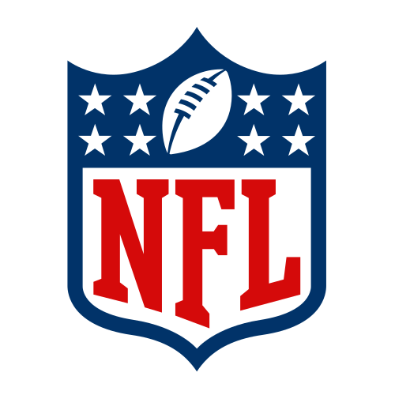
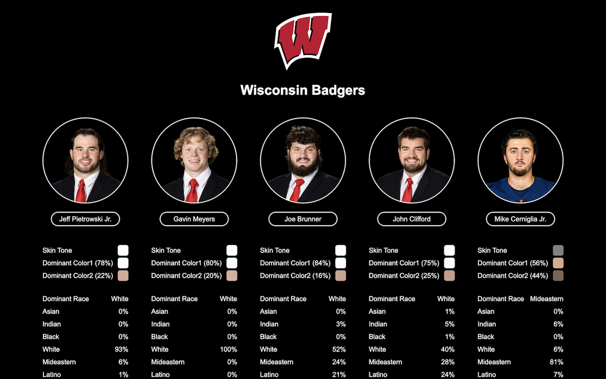

<p align="center">
  <div align="center">
    
    <br />
    
     
  </div>
</p>

# Athlete Classifier

The Athlete Classifier is a simple utility for downloading, organizing, and classifying NFL and NCAA athelete data using the [ESPN API](API.md).  It can be used to perform various types of analysis of player data, including ethnographic analysis.



The utility performs the following functions:

### 1. Downloading 
The utility downloads the data using the ESPN API and organizes the JSON and image data into a convenient folder structure.

### 2. Indexing
While downloading the data, the utility stores it into a relational database for easy querying and analysis. 

### 3. Classifying
The utility performs an ethnographic / demographic classification of players based upon their headshots.

## Requirements

### 1. PHP, Python
The utility relies upon the PHP and Python scripting languages.

### 2. SQL Database
The data is stored in a SQL database for easy querying and analysis.  You will need MySQL, MariaDB, or an equivalent.

### 3. DeepFace
The [DeepFace](https://github.com/serengil/deepface) utility is used to perform an image based ethnographic / demographic classification of players.

## Installation

### 1. Database

Create a database called "athletics".  Then, run [database/athletics.sql](database/athletics.sql) to create the required table structure.

### 2. DeepFace
Please install the DeepFace utility using the instructions provided [here](https://github.com/serengil/deepface).

## Configuration

### 1. Database
To configure the scripts to write to your database, locate the file "utilities/database". Please make sure that the following database settings are correct for your database instance:

```
define('DATABASE_HOST', '127.0.0.1');
define('DATABASE_USERNAME', 'root');
define('DATABASE_PASSWORD', 'root');
define('DATABASE_NAME', 'athletics');
```

## Running
Scripts are provided for fetching and processing both athletes and teams: 

### 1. Athletes

The script 'fetch_athletes.php' fetches and classifies player data and headshots. Since there are  many thousands of players in the database, they are divided up into folders based upon the first letter of the player's last name.  The complete NFL dataset includes about 12,000 players with headshots is over 3GB in size. The NCAA dataset includes about 200,000 players.

```
cd src
php fetch_athletes.php NFL
php fetch_athletes.php NCAA
```

### 2. Teams

The script 'fetch_teams.php' fetches team data and logos.

```
cd src
php fetch_teams.php NFL
php fetch_teams.php NCAA
```

## Data
Below are sample athlete and team datasets produced from running this software (March 2024):

1. [nfl_athletes.csv](data/nfl_athletes.csv)
2. [nfl_teams.csv](data/nfl_teams.csv)

<!-- LICENSE -->
## License

Distributed under the MIT License which allows urestricted use of the software. See [LICENSE.txt](LICENSE.txt) for more information.

<!-- CONTACT -->
## Acknowledgements
This software was made possible by the following organizations:

1. [University of Wisconsin](http://wisc.edu) [Data Science Institute](http://datascience.wisc.edu)

Thank you to the Data Science Institute for support.

2. [ESPN](http://espn.com)

Thank you to ESPN for providing access to their data through their API.  This software was created without involvement from or any association with the ESPN organization.

<!-- CONTACT -->
## Contact

Abe Megahed - (mailto:amegahed@wisc.edu)
